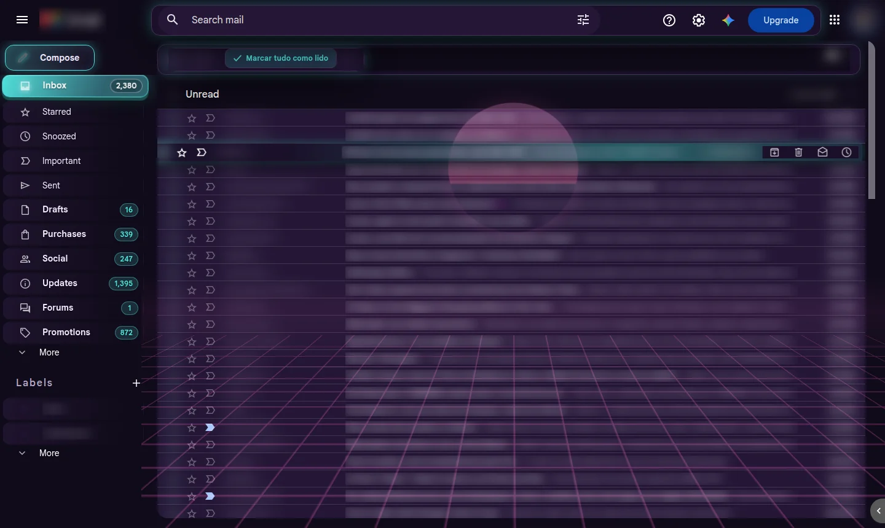
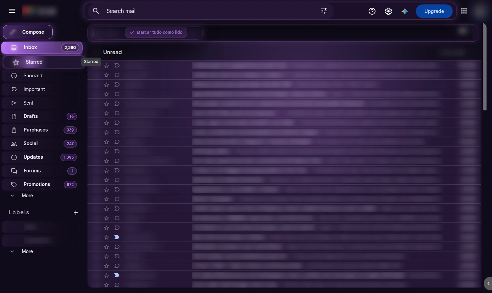
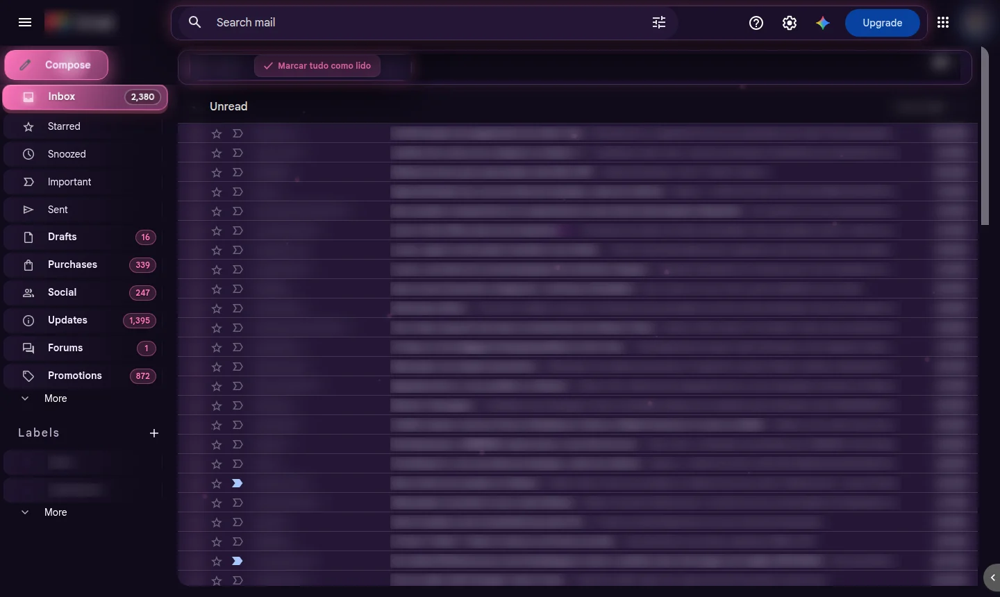
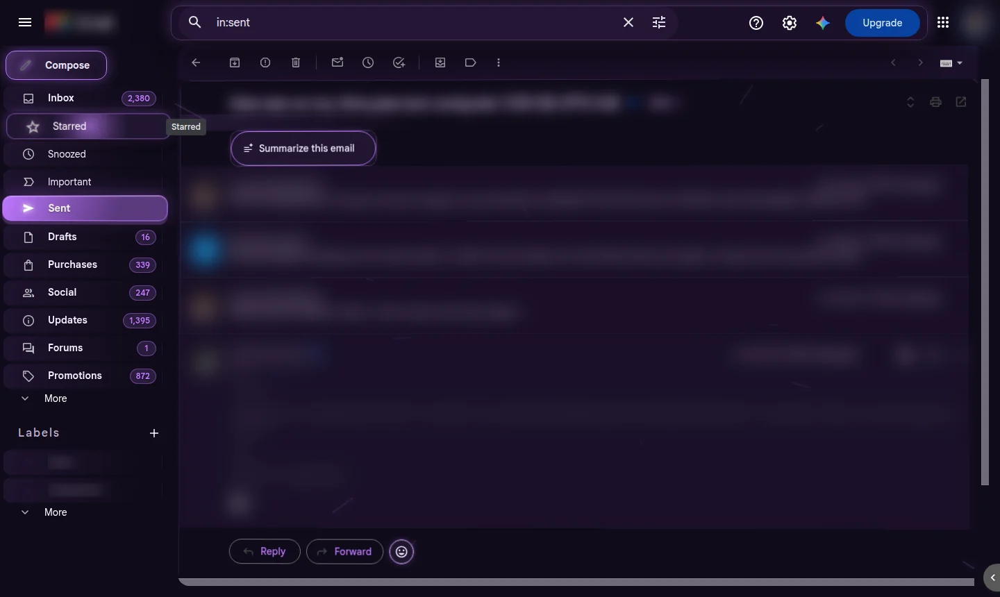
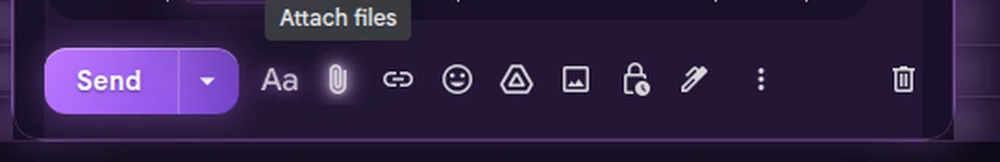

# GM Neon para Gmail

**GM Neon** é uma extensão gratuita para o Google Chrome que transforma o visual do Gmail num tema escuro neon, com fundos animados e efeitos 3D que acompanham o mouse.

É só aparência: a extensão muda cores, botões, menus e animações direto na página do Gmail aberta no seu navegador. Ela **não lê seus e-mails para enviar a lugar nenhum**, não usa a API do Gmail, não tem servidor e não coleta dados.

> Projeto independente, sem relação com o Google. "Gmail" é marca do Google LLC.

## Como fica

| Roxo com fundo aurora: o menu lateral em cartões 3D | Rosa com fundo de estrelas |
|---|---|
|  |  |

**Conversa aberta:** a caixa principal inclina de leve e brilha seguindo o mouse.

**Rodapé do compose:** ícones brancos animados e o botão Enviar em degradê neon.

Nas imagens, remetentes, assuntos e conteúdo aparecem desfocados para preservar a privacidade. O "Modo discreto" da extensão faz um efeito parecido.

## O que ela faz

### Visual
- **Tema escuro neon** em todo o Gmail: caixa de entrada, conversa aberta, busca, configurações, menus e pop-ups.
- **5 cores de destaque**: roxo, azul, rosa, ciano e verde.
- **10 fundos animados**: aurora suave, estrelas cintilantes, chuva Matrix, grade synthwave, bolhas de luz, hiperespaço, chuva neon, vaga-lumes, órbitas de luz ou nenhum.
- **Ícone que muda de cor**: o ícone da extensão na barra do Chrome acompanha a cor escolhida.
- **Correção automática de contraste**: partes que o Gmail deixa claras (cartão do Google Tradutor, abas das Configurações, chips) ficam escuras, e textos escuros sobre fundo escuro ficam claros. E-mails em HTML com texto escuro são convertidos para o modo escuro, e as imagens ficam com as cores originais.

### Efeitos 3D que seguem o mouse
- **Linhas de e-mail** inclinam conforme a posição do cursor.
- **Menu lateral**: cada pasta vira um cartão 3D que inclina, brilha e ganha relevo. A pasta atual fica destacada na cor do tema e os contadores viram badges.
- **Botões** (Escrever, barra de ferramentas, Responder e Encaminhar) inclinam com um pequeno brilho no ponto onde o mouse está.
- **Conversa aberta**: a caixa principal inclina de leve (no máximo cerca de 1,5°, para não atrapalhar a leitura) e o brilho neon acompanha o cursor em qualquer ponto da tela.

### Escrever e-mails
- O compose fica escuro e legível.
- Os botões do rodapé ficam brancos e animados.
- Enviar vira um botão em degradê neon com brilho e pulso.
- Abrir, fechar e enviar têm animações.

### Atalhos úteis
- **Marcar tudo como lido**: botão na barra da Caixa de entrada e no popup. Ele pede confirmação e usa os próprios controles do Gmail.
- **Modo discreto** (**Alt+P**): desfoca remetentes, assuntos e o corpo da conversa, que ficam visíveis só sob o mouse. Útil para compartilhar a tela.

## Instalar

A extensão ainda não está na Chrome Web Store. A instalação é manual e leva um minuto:

1. Baixe o ZIP da [última versão](https://github.com/lukscf/gmail-neon/releases/latest) (ou clone este repositório).
2. Extraia o ZIP numa pasta que você não vá apagar.
3. Abra `chrome://extensions` e ligue o **Modo do desenvolvedor** (canto superior direito).
4. Clique em **Carregar sem compactação** e escolha a pasta `gmail-neon-extension`.
5. Recarregue a aba do Gmail.

Feita e testada no Chrome, com contas pessoais e do Google Workspace. Deve funcionar também no Edge, no Brave e em outros navegadores baseados no Chromium.

### Atualizar
Extraia o ZIP novo por cima da pasta antiga, clique em **↻** no cartão do GM Neon em `chrome://extensions` e recarregue o Gmail.

## Configurar

Clique no ícone do GM Neon na barra do Chrome. Se ele não aparecer, procure no botão de quebra-cabeça. No popup você pode:

| Opção | O que faz |
|---|---|
| Tema neon | Liga ou desliga todo o visual |
| Hover 3D com o mouse | Liga ou desliga as inclinações e brilhos que seguem o cursor |
| Animar o compositor | Animações ao abrir, fechar e enviar e-mails |
| Modo discreto | Desfoca o conteúdo (também por Alt+P) |
| Cor do tema | Roxo, azul, rosa, ciano ou verde |
| Fundo animado | Um dos 10 fundos |
| Marcar tudo como lido | Marca a Caixa de entrada como lida |

A linha de diagnóstico no rodapé do popup mostra a versão e em qual conta (u/0, u/1…) a extensão está ativa.

Quem ativou **Reduzir movimento** no sistema operacional não vê as animações e inclinações.

## Privacidade e permissões

| Permissão | Para quê |
|---|---|
| `storage` | Guardar suas preferências (cor, fundo, opções) no próprio Chrome |
| `activeTab` | O popup conversar com a aba do Gmail aberta (diagnóstico e "marcar tudo como lido") |
| `https://mail.google.com/mail/*` | Aplicar o tema só nas páginas do Gmail |

- Nada sai do seu computador: não há servidor, analytics nem chamadas de rede.
- A extensão não usa a API do Gmail nem pede login.
- A única ação que altera a conta é **Marcar tudo como lido**, que só roda quando você clica e confirma.

## Como funciona

| Arquivo | Papel |
|---|---|
| `manifest.json` | Manifest V3 da extensão |
| `theme.css`, `effects.css`, `ui.css` | Tema, fundos animados e redesenho dos componentes do Gmail |
| `content.js` | Efeitos que seguem o mouse, correção de contraste, modo escuro dos e-mails e botão de marcar como lido |
| `background.js` | Troca o ícone da barra conforme a cor escolhida |
| `popup.html`, `popup.css`, `popup.js` | Tela de configurações |
| `icons/` | Ícones em 16, 32, 48 e 128 px, um conjunto por cor |

Os efeitos usam um único `pointermove` passivo e `requestAnimationFrame`, só com variáveis CSS e transformações, para não pesar na página.

## Limites conhecidos

- O Gmail muda o HTML com frequência. Se alguma parte voltar ao visual original depois de uma atualização do Gmail, [abra uma issue](https://github.com/lukscf/gmail-neon/issues).
- Em `chrome://extensions` o ícone fica sempre roxo, porque o Chrome não permite trocá-lo ali. Na barra ele muda.
- Se a extensão não aparecer numa conta (por exemplo, a da empresa), abra o popup nessa aba e leia o diagnóstico. A conta pode estar em outro perfil do Chrome, que precisa ter a extensão instalada também. A empresa também pode ter bloqueado extensões: confira em `chrome://policy`.

## Histórico

Veja o [CHANGELOG.md](CHANGELOG.md).
